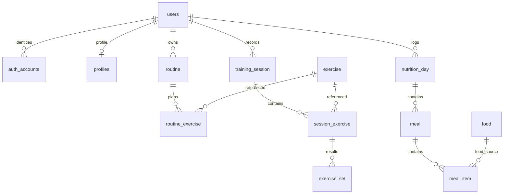

# Product data model review

Reviewed on 20 October 2026 for [DAT01](https://github.com/kinetix-app/management/issues/11), against the published Sprint 1 increments and the implementation on `feature/dat01-product-data-model`.

## Scope and verdict

[db-schema.sql](../db-schema.sql) is a design draft, not the deployed schema or a bootstrap script. Only `users`, `auth_accounts` and `profiles` have ORM models and an Alembic revision. The draft now includes the requested unified serial-ID design and business-level validation policy, so it intentionally differs from the current account migration. Feature issues own subsequent models and migrations. The existing `database-schema.png` predates the account correction and is not an authoritative diagram.

The draft is a useful starting point for Sprint 1, but does **not yet meet all its requirements**. Its routine/session/set separation and food/meal/day structure fit the selected journeys. Goal semantics, business validation and history behavior still need detailing before feature implementation. The exercise catalogue now has explicit, reusable fields based on Ascend, supporting manual entry and optional imports. No runtime migration or import service was implemented by this review.

## Confirmed design direction

- Use `BIGSERIAL PRIMARY KEY` for every independently generated local entity ID, including `users.id` and `auth_accounts.id`. All references use `BIGINT` without a sequence/default of their own. `profiles.user_id` is a shared `BIGINT` primary/foreign key: a profile reuses its user ID. Every table therefore has the same underlying PostgreSQL BIGINT key type. Provider IDs and Clerk issuer/subject values remain text because they are external identifiers.
- Validate business rules in schemas/services: allowed states, bounds, one food-or-recipe source per meal item, duplicate identities, day records and positions. Remove the commented SQL CHECK/UNIQUE proposals. Primary keys, foreign keys and required columns remain structural definitions in this draft.
- Use a common exercise table for manually entered exercises and optional provider imports. Reuse Ascend's documented exercise fields as explicit columns; provider metadata is optional for manual entry.
- Leave the remaining product decisions pending the owner's response.

The account tables retain the migrated status, identity and profile fields, timezone-aware timestamps, identity-owner index and deletion relationships. Passwords, email and first/last names are not local account columns. SQLAlchemy maintains `updated_at`; there is no database trigger.

**Runtime compatibility:** [revision 20261013_01](../migrations/versions/20261013_01_accounts.py), account ORM models, response schemas and services still use UUID users and UUID authentication-account IDs. Existing account CHECK/UNIQUE constraints remain in the running database. Applying this design needs a new migration mapping existing user and authentication-account UUIDs to serial IDs while preserving identity/profile relationships, plus integer ID handling in backend contracts and tests. Do not edit the applied revision or cast UUIDs to integers. The current account resolver relies on identity uniqueness conflicts to handle concurrent first access; its replacement must serialize same-identity provisioning in the service before that UNIQUE constraint is removed. Ordinary check-then-insert is insufficient for concurrent requests.

Nullable catalogue/routine owners do not automatically grant public access. Services must derive personal ownership from `CurrentUser` and reject cross-account references and reads.

The diagram shows selected core relationships only. Routine origin on a session is optional; a meal item may instead reference a recipe. Only the account relationships are migrated.

## Sprint 1 fit and remaining work

| Selected requirement | Draft support | Smallest remaining change or decision |
|---|---|---|
| [Account access](https://github.com/kinetix-app/app-rest/issues/8), [persistence](https://github.com/kinetix-app/app-rest/issues/9), [isolation](https://github.com/kinetix-app/app-rest/issues/10) | Migrated UUID accounts; proposed owned records consistently reference the planned serial user ID. | Migrate account IDs, then implement owned feature APIs and two-account persistence/isolation tests. Account/provider completion remains tracked separately. |
| [Selected objective](https://github.com/kinetix-app/app/issues/3) | `physical_goal.goal_type` is unconstrained; every goal requires a numeric target. | Represent build muscle, lose fat, gain weight and maintain weight explicitly. Store the selected objective independently of an optional measurable target; do not equate body weight with muscle/fat progress. |
| [Dated baseline](https://github.com/kinetix-app/app/issues/9), [baseline review](https://github.com/kinetix-app/app/issues/10) | `body_measurement.date` and `weight_kg` support a dated weight observation with a unit. | Validate at least one measurement and bounds. Agree how the baseline is associated with the selected goal; additional measures depend on DEC-01. |
| [Chosen targets](https://github.com/kinetix-app/app/issues/14) | `goal_milestone`, `activity_goal`, `nutrition_goal` cover the broad categories. | Define milestone metric/unit and goal relationship, weekly session target/period, and which goal/target is current. `physical_goal.target_value` lacks a metric/unit; milestones inherit that ambiguity. Resolve relevant DEC-01/02 rules. |
| [Saved routines](https://github.com/kinetix-app/app/issues/4), [session start](https://github.com/kinetix-app/app/issues/15) | Ordered exercise references and planned sets/reps/kg are present. | Require personal routine ownership for the Sprint 1 flow; validate positive positions and uniqueness within a routine in services. Supply at least eight catalogue exercises; save/start a three-exercise example. |
| [Set recording](https://github.com/kinetix-app/app/issues/16), [completion](https://github.com/kinetix-app/app/issues/18), [reopen](https://github.com/kinetix-app/app/issues/19), [history](https://github.com/kinetix-app/app/issues/21), [units](https://github.com/kinetix-app/app/issues/22) | Actual results live in `exercise_set`, separately from routine templates. | Validate order/set-number uniqueness and numeric/date bounds in services. Copy the exercise selection/order into the session at start; never reconstruct actual results from the current routine. Treat `ended_at` as completion for this simple flow, use `TIMESTAMPTZ` for events and define the user's local display date. Classify the selected gym catalogue explicitly as kg/repetitions. |
| [Manual foods](https://github.com/kinetix-app/app/issues/5), [portion logging](https://github.com/kinetix-app/app/issues/23) | Foods have per-100-g values in comments; items have gram quantities and meals belong to a date. | Make manual foods owned/private, document kcal and grams in the API, validate nonnegative nutrients, positive portions and exactly one food-or-recipe source with the matching quantity in services. |
| [Proportional calculation](https://github.com/kinetix-app/app/issues/24), [daily target comparison](https://github.com/kinetix-app/app/issues/25), [separate dates](https://github.com/kinetix-app/app/issues/27) | Day/meal/item joins support totals. | Keep one nutrition day per `(user_id, date)` through service logic that also handles concurrent requests. Agree decimal calculation/rounding and whether changed foods, recipes or targets alter earlier days; the current joins recalculate history from current definitions. |
| [Form](https://github.com/kinetix-app/app-rest/issues/4) and [coach](https://github.com/kinetix-app/app-rest/issues/5) research | No AI tables. | Sufficient for research-only Sprint 1 scope. Keep suggested outputs separate from chosen targets and actual records when delivery is selected. |

Business validation is an implementation requirement, rather than a missing database-constraint requirement. Services must authorize private food/routine references and handle concurrent operations where uniqueness matters. Index owner/date and reference lookup paths only with their consuming queries.

Nutrition calculation is `reference_value * quantity_grams / 100`; 150 g contributes 1.5 times the reference value. `DECIMAL(8,2)` storage alone does not define intermediate precision or when to round a daily total. Use decimal arithmetic and agree rounding with the nutrition implementer. Historical nutrition semantics need a product-owner decision: if past values must remain fixed, capture consumed nutrient values or reference immutable versions. Do not add versioning machinery before that decision.

## Exercise catalogue fields

Reviewed official [V1 exercise detail](https://docs.ascendapi.com/api-reference/exercisedb-v1/exercises/getexercisebyid) and [V2 exercise detail](https://docs.ascendapi.com/api-reference/exercisedb-v2/exercises/getexercisebyid). Ascend provides the field vocabulary for our own exercise catalogue. Exercises can be filled manually, and do not require an Ascend account, download or external ID. No importer is implemented here.

The `exercise` table exposes the documented V1/V2 exercise fields directly, using snake_case. Array fields retain multiple values and instruction order. Only resolution-to-URL maps use JSONB. There is no whole-exercise JSON payload.

| Ascend field | Local column/type |
|---|---|
| `exerciseId` | Optional `external_id TEXT`; the local primary key remains serial `id`. |
| `name`, `overview` | `name TEXT`, `overview TEXT`. |
| `bodyParts`, `equipments` | `body_parts TEXT[]`, `equipments TEXT[]`. |
| V1 `exerciseTypes`, V2 `exerciseType` | `exercise_types TEXT[]`; a V2 singular value becomes a one-element array. |
| `targetMuscles`, `secondaryMuscles` | `target_muscles TEXT[]`, `secondary_muscles TEXT[]`. |
| `instructions`, `exerciseTips` | `instructions TEXT[]`, `exercise_tips TEXT[]`. |
| `variations`, `keywords` | `variations TEXT[]`, `keywords TEXT[]`. |
| V1 `difficulty` | `difficulty TEXT`. |
| `relatedExerciseIds` | `related_exercise_ids TEXT[]`, retaining identifiers in the source dataset. |
| `videoUrl`, `imageUrl` | `video_url TEXT`, `image_url TEXT`. |
| `imageUrls`, V1 `gifUrls` | `image_urls JSONB`, `gif_urls JSONB`, preserving resolution keys such as `360p`. |

Local metadata stays small: nullable creator `user_id`, local `sport_id`, `source` defaulting to `manual`, optional `external_id` and optional `imported_at`. Manually entered records need a name and sport; other descriptive/media fields can be filled progressively and validated by services. A creator identifies ownership, not publication status. Routine and session references always use the local numeric `exercise.id`.

`related_exercise_ids` preserves the provider's descriptive relationship field; it is not a foreign-key list of local exercise IDs. Manual entries can leave it empty. A future importer can resolve related provider IDs within the same source when needed, without making import completeness a condition of creating an exercise.

Manual entry is the immediate catalogue workflow. If importing later, identify rows by `(source, external_id)` and preserve their local IDs when updating metadata. Business logic handles duplicate detection. The [provider policy](https://docs.ascendapi.com/guides/caching) still applies to downloaded information, and imported media links require refresh; manually supplied exercise information has no provider dependency.

Exercise classifications do not determine workout units. The selected gym flow still needs service/UI configuration for kilograms and repetitions. Actual completed sets remain separate from editable catalogue metadata.

## Implementation order and later scope

1. Keep the existing account migration as the base; add a follow-up serial-ID migration and account-contract changes before using this draft at runtime.
2. Settle goal/baseline/target fields (DEC-01/02), then add their feature migrations.
3. Add catalogue and routine/session/set migrations with business validation in services. Populate the catalogue manually using the common exercise fields; add an importer only when needed.
4. Agree nutrition precision/history behavior, then add owned food/day/meal/item and target migrations. Recipes can follow their selected consuming feature.

Feed/post audiences, Jam membership linked to each participant's own session, league membership/scoring linked to existing workouts, and Market collections retaining item references/creator attribution are absent. They remain conceptual later work, with DEC-04–10 unresolved. Recipes and additional body measures in the draft are not evidence of Sprint 1 delivery. Integrated AI feedback, upload storage and suggestion history can wait for their consuming features and DEC-11/12.

The next review should check these decisions and the selected feature migrations. SQL execution proves structural validity only; it cannot establish ownership, historical behavior, calculations or feature acceptance.

## Verification

The previous runtime checks passed: lockfile, Ruff lint/format, 106 non-integration tests and 11 integration tests. They cover the existing UUID account implementation, not the proposed serial-ID migration. The account-schema comparison from the earlier revision no longer applies because the draft now intentionally differs.

The exercise-column revision passed an isolated PostgreSQL check: all 21 tables execute, manual exercises can be created without provider metadata, descriptive fields and ordered arrays/media maps persist, and existing routine references work. Temporary schemas and records were rolled back. No runtime migration, live provider download or business-validation implementation is included in this change.

The unified-ID draft also passed PostgreSQL execution: all 21 tables have BIGINT primary keys, the 20 independent IDs use sequences, and all 28 foreign keys match BIGINT targets. User and authentication-account IDs generate automatically; profiles reuse the user ID. The duplicate users primary-key declaration was removed. Test schemas and records were rolled back.
