# Kinetix data model

This diagram reflects the [PostgreSQL schema reference](../db-schema.sql). The Alembic chain initializes the product tables, converts existing UUID accounts to generated BIGINT IDs and adds workout retries and resumable snapshots. See the [README](../README.md) for implemented API behavior and verification. Existing account constraints are retained.

`BIGSERIAL` is shown as `bigint` with a generated-value note. All local keys/references use BIGINT. `PK` = primary key, `FK` = foreign key, `UK` = unique column. Nullable references allow zero or one parent; each parent can have zero or many children unless the child key is unique. Auth identity uniqueness applies to the issuer/subject pair. Category values are documented beside their VARCHAR columns in the SQL.

```mermaid
erDiagram
    direction LR
    users {
        bigint id PK "generated; required"
        varchar status "VARCHAR(16); required"
        timestamptz created_at "required"
        timestamptz updated_at "required"
    }

    auth_accounts {
        bigint id PK "generated; required"
        bigint user_id FK "required"
        varchar issuer "VARCHAR(512); required; unique issuer + subject pair"
        varchar subject "VARCHAR(255); required; unique issuer + subject pair"
        timestamptz created_at "required"
    }

    profiles {
        bigint user_id PK,FK "required"
        varchar display_name "VARCHAR(100); nullable"
        varchar timezone "VARCHAR(100); nullable"
        timestamptz created_at "required"
        timestamptz updated_at "required"
    }

    food {
        bigint id PK "generated; required"
        bigint user_id FK "nullable"
        varchar name "VARCHAR(150); required"
        varchar brand "VARCHAR(100); nullable"
        decimal calories "DECIMAL(8,2); required"
        decimal protein "DECIMAL(8,2); required"
        decimal carbohydrates "DECIMAL(8,2); required"
        decimal fats "DECIMAL(8,2); required"
        varchar barcode "VARCHAR(50); nullable"
    }

    recipe {
        bigint id PK "generated; required"
        bigint user_id FK "nullable"
        varchar name "VARCHAR(150); required"
        text description "nullable"
        text instructions "nullable"
        integer servings "required"
    }

    recipe_ingredient {
        bigint id PK "generated; required"
        bigint recipe_id FK "required"
        bigint food_id FK "required"
        decimal quantity_grams "DECIMAL(8,2); required"
    }

    nutrition_day {
        bigint id PK "generated; required"
        bigint user_id FK "required"
        date date "required"
    }

    meal {
        bigint id PK "generated; required"
        bigint nutrition_day_id FK "required"
        varchar meal_type "VARCHAR(30); required"
    }

    meal_item {
        bigint id PK "generated; required"
        bigint meal_id FK "required"
        bigint food_id FK "nullable"
        bigint recipe_id FK "nullable"
        decimal quantity_grams "DECIMAL(8,2); nullable"
        decimal servings "DECIMAL(8,2); nullable"
    }

    nutrition_goal {
        bigint id PK "generated; required"
        bigint user_id FK "required; unique"
        decimal calories "DECIMAL(8,2); required"
        decimal protein "DECIMAL(8,2); required"
        decimal carbohydrates "DECIMAL(8,2); required"
        decimal fats "DECIMAL(8,2); required"
    }

    exercise {
        bigint id PK "generated; required"
        bigint user_id FK "nullable"
        varchar activity_type "VARCHAR(30); required"
        text name "required"
        text overview "nullable"
        text[] body_parts "nullable"
        text[] equipments "nullable"
        varchar[] exercise_types "VARCHAR(50)[]; nullable"
        text[] target_muscles "nullable"
        text[] secondary_muscles "nullable"
        text[] instructions "nullable"
        text[] exercise_tips "nullable"
        text[] variations "nullable"
        text[] keywords "nullable"
        varchar difficulty "VARCHAR(20); nullable"
        text[] related_exercise_ids "nullable"
        text video_url "nullable"
        text image_url "nullable"
        jsonb gif_urls "nullable"
        varchar source "VARCHAR(30); required"
        text external_id "nullable"
        timestamptz imported_at "nullable"
        jsonb image_urls "nullable; resolution to seeded URL"
    }

    routine {
        bigint id PK "generated; required"
        bigint user_id FK "nullable"
        varchar name "VARCHAR(150); required"
        text description "nullable"
        timestamp created_at "nullable"
    }

    routine_exercise {
        bigint id PK "generated; required"
        bigint routine_id FK "required"
        bigint exercise_id FK "required"
        integer exercise_order "required"
        text notes "nullable"
    }

    routine_exercise_set {
        bigint id PK "generated; required"
        bigint routine_exercise_id FK "required"
        integer set_number "required"
        integer reps "nullable"
        decimal weight_kg "DECIMAL(12,6); nullable"
        integer duration_seconds "nullable"
        decimal distance_km "DECIMAL(8,2); nullable"
    }

    training_session {
        bigint id PK "generated; required"
        bigint user_id FK "required"
        bigint routine_id FK "nullable"
        varchar activity_type "VARCHAR(30); required"
        timestamptz started_at "required"
        timestamptz ended_at "nullable; completed when present"
        text notes "nullable"
        uuid client_session_id "nullable for legacy; unique with user_id"
        varchar payload_fingerprint "VARCHAR(64); nullable for legacy"
    }

    session_draft {
        bigint id PK "generated"
        bigint user_id FK "required"
        uuid client_session_id "unique with user_id"
        jsonb snapshot "ordered exercises and confirmed/unconfirmed sets"
        bigint completed_session_id FK "nullable; immutable finish retry pointer"
        boolean finish_update_routine "required; frozen on completion"
    }

    session_exercise {
        bigint id PK "generated; required"
        bigint session_id FK "required"
        bigint exercise_id FK "required"
        integer exercise_order "required"
        text notes "nullable"
    }

    exercise_set {
        bigint id PK "generated; required"
        bigint session_exercise_id FK "required"
        integer set_number "required"
        integer reps "nullable"
        decimal weight_kg "DECIMAL(12,6); nullable"
        integer duration_seconds "nullable"
        decimal distance_km "DECIMAL(8,2); nullable"
        boolean completed "required"
    }

    physical_goal {
        bigint id PK "generated; required"
        bigint user_id FK "required"
        varchar goal_type "VARCHAR(50); required"
        decimal target_value "DECIMAL(8,2); required"
        date start_date "required"
        date target_date "nullable"
        timestamp completed_at "nullable"
    }

    body_measurement {
        bigint id PK "generated; required"
        bigint user_id FK "required"
        date date "required"
        decimal weight_kg "DECIMAL(5,2); nullable"
        decimal body_fat_percentage "DECIMAL(5,2); nullable"
        decimal muscle_mass_kg "DECIMAL(5,2); nullable"
        decimal waist_cm "DECIMAL(5,2); nullable"
        decimal chest_cm "DECIMAL(5,2); nullable"
        decimal arm_cm "DECIMAL(5,2); nullable"
        decimal thigh_cm "DECIMAL(5,2); nullable"
    }

    users ||..o{ auth_accounts : "user"
    users ||--o| profiles : "user"
    users o|..o{ food : "user"
    users o|..o{ recipe : "user"
    recipe ||..o{ recipe_ingredient : "recipe"
    food ||..o{ recipe_ingredient : "food"
    users ||..o{ nutrition_day : "user"
    nutrition_day ||..o{ meal : "nutrition_day"
    meal ||..o{ meal_item : "meal"
    food o|..o{ meal_item : "food"
    recipe o|..o{ meal_item : "recipe"
    users ||..o| nutrition_goal : "user"
    users o|..o{ exercise : "user"
    users o|..o{ routine : "user"
    routine ||..o{ routine_exercise : "routine"
    exercise ||..o{ routine_exercise : "exercise"
    routine_exercise ||..o{ routine_exercise_set : "routine_exercise"
    users ||..o{ training_session : "user"
    routine o|..o{ training_session : "routine"
    users ||..o{ session_draft : "owned snapshot; one active per account"
    training_session o|..o{ session_draft : "completed workout"
    training_session ||..o{ session_exercise : "session"
    exercise ||..o{ session_exercise : "exercise"
    session_exercise ||..o{ exercise_set : "session_exercise"
    users ||..o{ physical_goal : "user"
    users ||..o{ body_measurement : "user"
```

Routine exercises and recorded session exercises each have numbered child sets with the same measurement fields. Loading uses the owner's latest nonempty completed occurrence per catalogue exercise, falling back to routine defaults. Performed exercises have no template-slot association; only confirmed draft sets become results on completion. Historical measurements and workout results remain separate from chosen targets and editable templates.

`meal_item` references either a food or a recipe; business logic validates that exactly one source and its matching quantity are provided. `body_measurement` belongs to the user and supports evolution and physical-goal progress without a direct goal foreign key. Array fields such as `related_exercise_ids` are provider metadata, not local foreign keys.

See the [data model review](data-model-review.md) for decisions, pending behavior and implementation status. The older `database-schema.png` is not synchronized with this draft.
